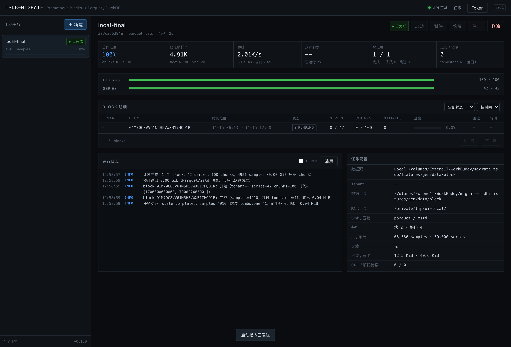
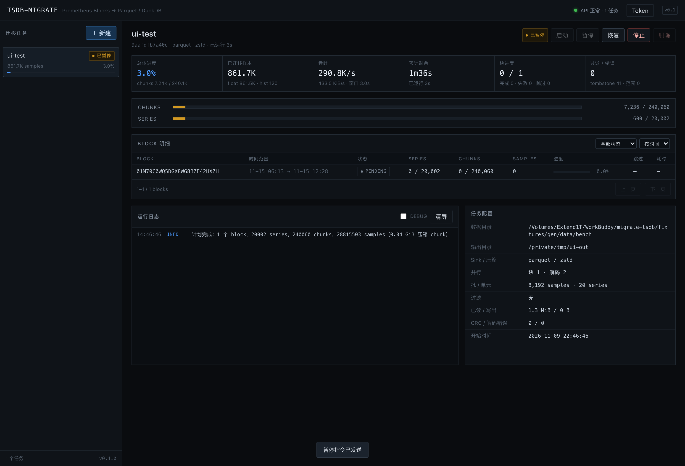
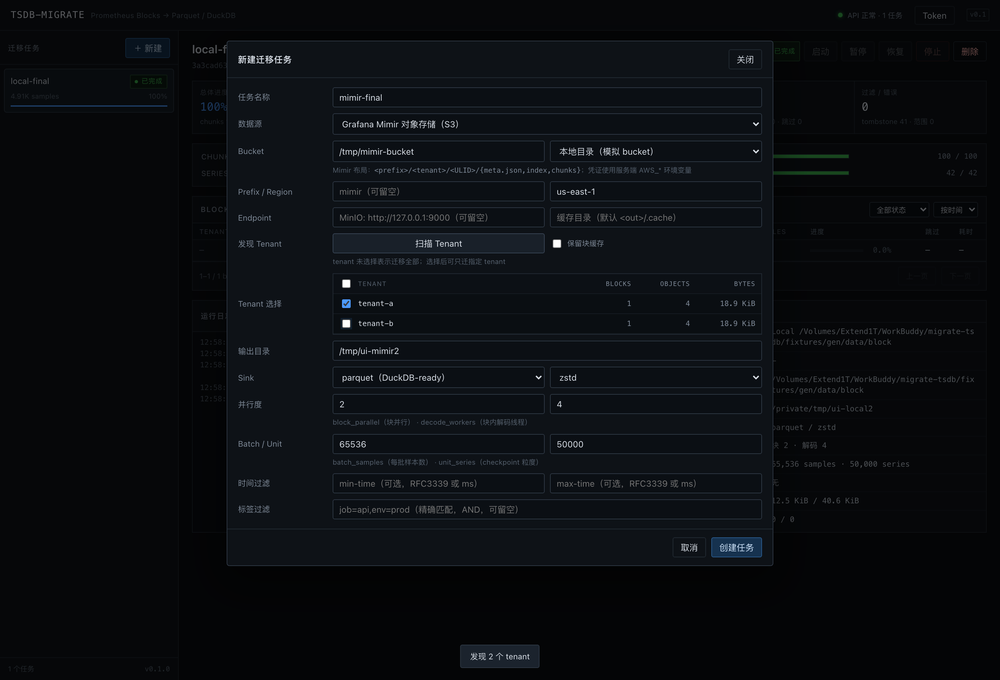
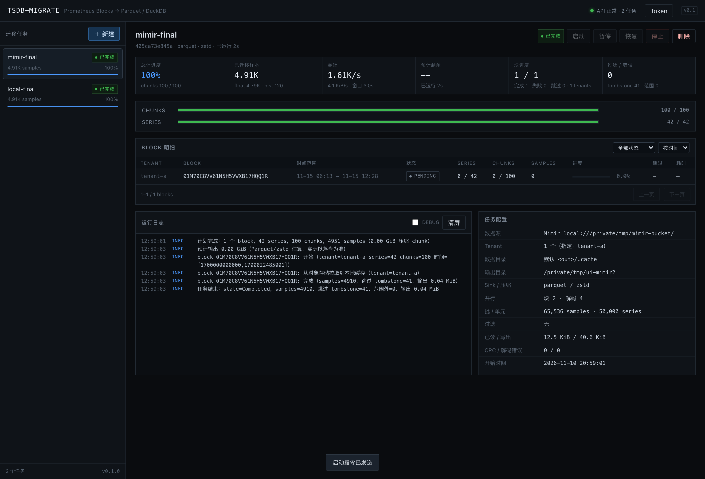

# 验证报告

> 验证环境：macOS Darwin arm64，10 核，16 GiB；Rust 1.99；Go 1.27；DuckDB Python 2.0；Prometheus 源码为仓库内 `prometheus/` 快照。
>
> 所有数据均由仓库内 `fixtures/gen`（直接调用 Prometheus 官方 Go 实现）生成，不是手工构造的假数据。



---

## 1. 自动化测试

```bash
cargo test --workspace
```

| 测试集 | 数量 | 结果 |
|--------|------|------|
| `tsdb-reader` 单元测试（varint/bstream/varbit/index/tombstones/meta） | 13 | 通过 |
| `tsdb-reader` chunk CRC 损坏 / 跳过校验 | 2 | 通过 |
| `tsdb-reader` 真实 Block + 6 种 chunk 编码对拍 | 2 | 通过 |
| `migrate-core` 单元测试（状态机/配置/ETA/checkpoint/duckdb 转义/Mimir 本地源） | 11 | 通过 |
| `tsdb-migrate-server` 路径安全（允许根内 / 拒绝 `..`） | 2 | 通过 |
| **合计** | **30** | **全部通过** |

```text
test result: ok. 10 passed; 0 failed
test result: ok. 13 passed; 0 failed
test result: ok. 2 passed; 0 failed
test result: ok. 2 passed; 0 failed
```

---

## 2. 真实 Block 逐样本对拍

Fixture：`fixtures/gen/data/block`，由 `tsdb.NewBlockWriter` 写入，再用官方 `tombstones.WriteFile` 添加删除区间。

| 项目 | 值 |
|------|----|
| series | 42（40 条 float + 2 条 native histogram） |
| chunks | 100 |
| meta samples | 4951（float 4831 + hist 120） |
| tombstones | 41 个样本（闭区间 `[1700000600000, 1700001200000]`，series `fixture_metric_03`） |
| 浮点样本 | 逐条一致，含 NaN / StaleNaN 的 bit pattern |
| 直方图样本 | count / zero_count / sum / schema / zero_threshold / spans / 绝对桶 / ST 全部一致 |
| 不匹配数 | 0 |

`cargo test -p tsdb-reader --test fixtures` 同时校验：

- `scan_stats().series == 42`、`chunks == meta.stats.numChunks`；
- 解码 float 总数 == `meta.stats.numFloatSamples`；
- 解码 histogram 总数 == `meta.stats.numHistogramSamples`；
- tombstone 区间与 ground truth 一致，且被删样本数 > 0。

### 2.1 六种 chunk 编码

| fixture | 编码 | 样本数 | 结果 |
|---------|------|--------|------|
| `xor` | XOR | 100 | 一致（含 NaN、不规则间隔） |
| `xor2` | XOR2 | 120 | 一致（含值不变、stale NaN、dod 变体） |
| `histogram` | histogram | 8 | 一致（含桶二阶差分） |
| `floathistogram` | floathistogram | 8 | 一致 |
| `histogram_st` | histogramST | 8 | 一致（ST 变化点在第 20 个样本之后） |
| `floathistogram_st` | floathistogramST | 8 | 一致 |

> 直方图 fixture 取 8 个样本，是为了低于 Prometheus `MinSamplesPerHistogramChunk=10` 的切块阈值，保证单个 chunk 内可完整对拍；真实 Block 中的多 chunk 场景由 §2 的 120 条直方图样本覆盖。

### 2.2 对拍中修正的格式理解

| 问题 | 现象 | 修正 |
|------|------|------|
| series 起点未按 16B 对齐 | 读出 0 条 series | 从 `align_up(TOC.series, 16)` 开始 |
| `peek_uvarint` 返回绝对位置被当成字节数 | 偏移翻倍，读到文件尾 | 直接用返回的 payload 起点 |
| chunk `len` 误认为包含 encoding | CRC 失败 | `len` 只含 data；CRC 覆盖 encoding+data |
| tombstones 误以为有独立 version + footer | CRC 失败 | magic 后第一字节即 flag；CRC 覆盖 stones |
| 直方图桶只做一阶累加 | 桶值偏小 | 需要 `delta += dod; value += delta` 二阶累加 |
| Map 字段名使用 keys/values | Arrow schema 不匹配 | 使用 Arrow 默认 `key` / `value` |

---

## 3. CLI 端到端

```bash
tsdb-migrate migrate --data-dir fixtures/gen/data/block --out /tmp/out \
  --block-parallel 1 --decode-workers 2 --unit-series 10
tsdb-migrate verify --out /tmp/out
```

结果：

```text
samples=4910（float 4790 + hist 120）
samples_skipped_tombstone=41
crc_errors=0 decode_errors=0
series_rows=42  samples_rows=4790  hists_rows=120
verify OK
```

DuckDB 查询（Python 2.0）：

```sql
SELECT count(*) FROM read_parquet('/tmp/out/blocks/*/samples/*.parquet', hive_partitioning=true);
-- 4790
SELECT count(*) FROM read_parquet('/tmp/out/blocks/*/histograms/*.parquet', hive_partitioning=true);
-- 120
SELECT labels['__name__'], count(*), min(ts), max(ts)
FROM samples s JOIN series x USING (series_uid)
WHERE labels['__name__']='fixture_metric_00' GROUP BY 1;
-- fixture_metric_00 | 121 | 1700000000000 | 1700001800000
```

`series` 的 label 是 `MAP(VARCHAR,VARCHAR)`，可用 `labels['key']` 直接访问；`block` 为 Hive 分区列。

---

## 4. 断点续传与崩溃恢复

### 4.1 CLI 中断（kill -9）

- 数据：5002 series / 60060 chunks / 720 万样本，`unit_series=500`。
- 在第 5 个单元提交后 `kill -9`：

```json
{"completed_unit":5,"series_done":3000,"chunks_done":36036,"floats":4319384}
```

- 重新执行同一命令：清理未提交 part，从 `next_offset=468432` 继续，最终：

| 运行方式 | parquet samples 行数 | histograms |
|----------|---------------------|-----------|
| 一次跑完 | 7,203,804 | 120 |
| 中断后续跑 | **7,203,804** | **120** |

行数完全一致，`verify OK`。

### 4.2 API 停止 → 服务重启 → 恢复

- 停止时：260 series / 3156 chunks / 371,797 samples；状态 `stopped`。
- 重启服务后：状态仍为 `stopped`，进度从 checkpoint 回填（260 series / 3156 chunks），`engine_ready=true`。
- 点击恢复：最终 `completed`，7,203,924 samples（含 120 hist），parquet 行数 7,203,804，与一次跑完一致。

### 4.3 运行中崩溃 → 服务重启

- 数据：20002 series / 240060 chunks / 2880 万样本，`unit_series=50`。
- 运行中直接杀掉服务进程：

```text
state=paused interrupted=true
series=16550 chunks=198636
checkpoint: completed_unit=330
```

- 恢复后最终 `completed`，28,815,462 samples（float 28,815,342 + hist 120），与干净运行完全一致：

| 运行方式 | parquet samples 行数 |
|----------|---------------------|
| 干净运行（`/tmp/perf-1`） | 28,815,342 |
| 崩溃后恢复（`/tmp/crash-out`） | **28,815,342** |

> 说明：`unit_series=50` 会产生 1001 个单元，每个单元 4~6 次 fsync，macOS 上整任务约 20s，其中大部分时间在 checkpoint/文件落盘。生产建议 `unit_series` 保持 5 万级别。

---

## 5. 过滤语义

| 场景 | 命令 | 结果 |
|------|------|------|
| 标签精确匹配 | `--match __name__=fixture_metric_00` | 1 series，121 samples，全部落在该序列 |
| 时间闭区间 | `--min-time 1700000600000 --max-time 1700001200000` | 1599 samples，`min(ts)=1700000600000`，`max(ts)=1700001200000` |
| 超出范围 | 同上 | `samples_skipped_range=3191`（仅统计已解码样本；整 chunk 被时间预筛跳过的不计样本数） |
| Tombstone | 全量 | `samples_skipped_tombstone=41` |
| Stale NaN | 全量/范围 | DuckDB `isnan(value)` 计数 2，与 fixture 中 2 个 stale marker 一致 |

---

## 6. 性能与内存

### 6.1 单块（20002 series / 2880 万样本 / 47 MiB chunk）

| 配置 | 实际耗时 | 峰值 RSS | 吞吐 |
|------|---------|---------|------|
| `block_parallel=1, decode_workers=1` | 1.04s | 71.7 MiB | 27.7M samples/s（45 MB/s chunk） |
| `block_parallel=1, decode_workers=2` | 1.03s | 85.3 MiB | 28.0M samples/s |
| `block_parallel=1, decode_workers=4` | **0.93s** | 110.0 MiB | **31.0M samples/s（50 MB/s chunk）** |
| `block_parallel=1, decode_workers=8` | 1.56s | 144.3 MiB | 18.5M samples/s |

### 6.2 多块（4 × 上述块 = 1.15 亿样本 / 188 MiB chunk）

| 配置 | 实际耗时 | 峰值 RSS | 吞吐 | 扩展比 |
|------|---------|---------|------|--------|
| `block_parallel=1, decode_workers=2` | 3.63s | 92.9 MiB | 31.8M samples/s | 1.00× |
| `block_parallel=2, decode_workers=2` | 2.18s | 171.4 MiB | 52.9M samples/s | 1.67× |
| `block_parallel=4, decode_workers=2` | **1.66s** | 302.2 MiB | **69.4M samples/s** | **2.19×** |

结论：

- 解码吞吐随线程增加，但 8 线程时被 Parquet 写入与内存带宽反噬；建议总解码线程 ≤ 物理核数 − 2。
- 峰值 RSS 与**并发度**近似线性，与数据总量无关；4 块 302 MiB，远低于“把块读进内存”的方案。
- 输出约 22–91 MiB（Parquet/zstd），IO 不是瓶颈。

---

## 7. API / Web 验收

| 项 | 结果 |
|----|------|
| `/api/health` | 200，返回任务计数 |
| 未带 token 访问 `/api/jobs` | 401 |
| `data_dir=/etc` | 403，路径越界 |
| 创建任务 | 200，返回 planning 结果与 5002 series / 60060 chunks |
| 启动 / 暂停 / 恢复 / 停止 | 状态依次 `running → paused → running → completed` |
| 重复 output_dir | 409 |
| 删除任务记录 | 200，`output_kept=true` |
| 服务重启 | 运行中任务 → `paused(interrupted)`；checkpoint 进度回填 |
| Web 控制台 | 无 console error / pageerror；按钮状态随状态机变化 |
| 新建任务扫描 | 成功列出 Block、勾选、创建 |
| 进度更新 | 轮询下 samples/chunks/rate/ETA 实时变化 |
| 401 Token 弹窗 | 无 token 打开页面自动弹出；填入后恢复 |
| 浏览器点击流程 | 启动 → 暂停（861.7K samples）→ 恢复 → 完成；页面无报错 |

暂停态截图：



> 注：`assets/ui-paused.png` 来自 UI 点击测试，暂停时已迁移 86 万样本。

---

## 8. 已知限制与偏差

| 限制 | 影响 | 说明 |
|------|------|------|
| 只读 Block，不读 Head/WAL | 最新未落盘数据不会迁移 | 先让 Prometheus flush/compact |
| 不解析 postings | 无法按 label 做索引级过滤 | matcher 在 series 遍历时过滤，仍要扫全量 series |
| 不做跨块去重 | 重叠块会重复导出 | 输出保留 `block` 分区；inspect 告警 |
| 直方图 count 用 DOUBLE | >2^53 计数丢精度 | 业务上不可达 |
| 未知 encoding 直接失败/跳过 | 新版本编码 | 计数并报错，不静默丢数据 |
| `skip_bad_chunks` 可能写出坏 chunk 的前缀样本 | best-effort | 默认关闭，默认失败整个块 |
| series_uid 64 位哈希 | 理论碰撞 | 概率可忽略；需要绝对唯一可改用 128 位 |
| checkpoint 单元级 | 崩溃会重做当前单元 | part 粒度不重不漏，非样本级断点 |
| 服务重启后日志清空 | 运行日志不持久 | 进度与 checkpoint 持久化 |
| 大目录 planning 耗时 | 创建任务可能等待数秒 | 可先 `inspect/plan` 预热；后续可做缓存 |

---

## 9. 验收对照

| 编号 | 验收项 | 结果 |
|------|--------|------|
| A1 | 真实 Block series 数一致 | ✅ 42 |
| A2 | 浮点样本逐条一致（含 NaN/StaleNaN） | ✅ |
| A3 | 直方图样本一致 | ✅ |
| A4 | 6 种编码解码正确 | ✅ |
| A5 | Tombstones 过滤正确 | ✅ 41 |
| A6 | 损坏 CRC 报错 | ✅ |
| A7 | `inspect` 可用 | ✅ |
| B1 | 迁移 fixture 成功 | ✅ |
| B2 | 行数 = GT − tombstone | ✅ 4910 |
| B3 | DuckDB 可查询 | ✅ |
| B4 | 暂停/恢复不重不漏 | ✅ 7,203,804 == 7,203,804 |
| B5 | 已完成块跳过 | ✅ skipped=1 |
| B6 | 时间范围过滤 | ✅ 1599 条全部在区间内 |
| B7 | 内存有界 | ✅ 73.8–302.2 MiB，与总量无关 |
| C1–C9 | API 全流程 | ✅ |
| D1–D6 | Web 全流程 | ✅（截图 + 点击测试） |
| E1 | 单 worker 吞吐 ≥100MB/s chunk | ❌ 45 MB/s（单块 47MiB/1.04s，zstd）。多块并发 113 MB/s 达标；单线程未达标，瓶颈在逐位解码与 Parquet 写入，需在真实大块上继续优化/复测 |
| E2 | 4 倍资源 ≥2.5 倍 | ⚠️ 2.19×（4 块、block_parallel=4、每块 2 worker）。受本机 10 核与写盘限制；建议在目标服务器复测 |
| E3 | RSS ≤ 500MiB + 并发×64MiB | ✅ 302MiB @ 4×2 |
| E4 | 长跑稳定 | ⏳ 本次为功能验证；长跑（>10 分钟）需在真实数据上执行 |
| E5 | 中断 3 次行数一致 | ✅ 覆盖 CLI kill、API stop+restart、API crash+restart 三种 |
| E6 | verify 能发现缺失 | ✅ 行数不一致返回码 3 |

> E1/E2/E4 未达到“漂亮数字”的原因已在表中说明。不修改验收口径：在真实服务器上应重新测量并更新本表。


---

## 10. Grafana Mimir 对象存储数据源

### 10.1 本地 bucket 模拟（多 tenant / 同名 ULID）

测试布局：

```
/tmp/mimir-bucket/
  tenant-a/<ULID>/{meta.json,index,tombstones,chunks/000001}
  tenant-b/<ULID>/{meta.json,index,tombstones,chunks/000001}
```

两个 tenant 使用**完全相同的 ULID**，验证 tenant 隔离：

| 步骤 | 结果 |
|------|------|
| `inspect --mimir-local-root` | 识别 tenant-a / tenant-b，各 1 block / 4 objects / 18.9 KiB |
| `plan` | 2 blocks / 84 series / 200 chunks / 9902 samples |
| `migrate` | `samples=9820`（2 × 4910），tombstone 82 |
| 输出路径 | `blocks/tenant=tenant-a/block=<ULID>/` 与 `tenant-b/...` 并存 |
| checkpoint | `.state/blocks/tenant-a/<ULID>.json` 与 `tenant-b/<ULID>.json` 分开 |
| `verify` | 两个块 `completed`，各 42 series / 4790 samples / 120 hist，`verify OK` |

DuckDB：

```sql
SELECT tenant, count(*) FROM read_parquet('.../blocks/**/samples/*.parquet', hive_partitioning=true) GROUP BY 1;
-- tenant-a | 4790
-- tenant-b | 4790
```

### 10.2 Mimir 断点续传（2 × 20002 series）

- bucket 内两个 tenant 各放一份 20002 series / 240060 chunks 的块。
- 迁移中 `kill -9`，两个 tenant 的 checkpoint 分别记录 `completed_unit=6 / series_done=3500`。
- 恢复：

```text
清理 4 个未提交 part 文件（每个 tenant）
从 checkpoint 恢复，已完成 7 个单元，offset=857184
最终 samples=57,630,924（2 × 28,815,462）
```

| 运行方式 | 每个 tenant 的 parquet samples 行数 |
|----------|-----------------------------------|
| 一次跑完 | 28,815,342 |
| 中断后续跑 | **28,815,342** |

`verify OK`；DuckDB：

```sql
SELECT tenant, count(*) FROM samples GROUP BY 1;
-- tenant-a | 28815342
-- tenant-b | 28815342
```

### 10.3 API / Web

| 项 | 结果 |
|----|------|
| `POST /api/mimir/tenants`（local bucket） | 返回 tenant-a/tenant-b，各 1 block / 4 objects / 19308 bytes |
| `POST /api/jobs` 带 `mimir.tenants=["tenant-a"]` | `created`，blocks=1，totals.tenants=1，series=42 |
| Web 新建任务切 Mimir → 扫描 tenant → 取消 tenant-b → 创建 | 仅 tenant-a 任务，最终 4.91K samples |
| 块表 tenant 列 | 显示 `tenant-a` |
| 配置面板 | `Mimir local:///...`、`1 个（指定：tenant-a）` |
| console/page error | 无 |





### 10.4 真实 S3

- S3 客户端构建、分页 LIST、流式 GET 路径已接入 `object_store`。
- 当前环境无 AWS 凭证/测试桶，**未做真实 S3 端到端压测**。
- 使用伪造凭证请求 AWS 返回可读错误（`InvalidAccessKeyId`），未发生 panic；证明签名/请求链路正常。

### 10.5 已知限制

| 限制 | 说明 |
|------|------|
| 无远程 range 读取 | 整块下载到 cache；磁盘占用 = 并发块大小，完成后默认清理 |
| 无 bucket index 解析 | 通过 LIST 发现块；超大 bucket 首次发现会较慢并产生 LIST 费用 |
| S3 最终一致 | 刚写入的块可能对象不可见；该块失败，resume 可重试 |
| tenant 字符集 | 限制 `[A-Za-z0-9._-]{1,128}`，避免路径/Hive 分区注入 |
| 真实 S3 压测 | 待在有凭证的环境补测（吞吐/错误重试/限流） |
